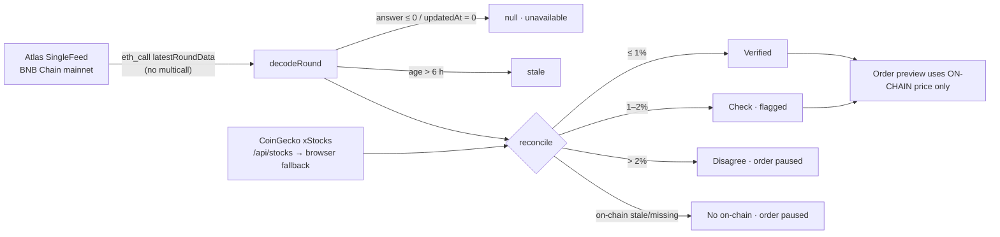

# 02 · Live data: on-chain prices (Atlas), off-chain witness (CoinGecko), yields, chain

## Goal

Every number in the app is live, comes from a named source, and fails visibly. Stock prices of record come **on-chain from Atlas on BNB Chain mainnet**. CoinGecko is an independent **off-chain witness**.

## Read first

- `web/src/lib/atlas.ts`, `live.ts`, `stocks.ts`, `yields.ts`, `wagmi.ts`
- `web/src/app/api/*/route.ts`
- `web/src/components/LiveStrip.tsx` and `LiveMarkets.tsx`
- `web/src/app/app/stocks/page.tsx`

## The price flow (implement exactly)

The steps, in order:

1. **Read on-chain.** For each stock, call `latestRoundData()` on its Atlas SingleFeed (`ATLAS_FEEDS` in `lib/atlas.ts`, 18 decimals). Use one viem `publicClient` with `chain: bsc` and a `fallback` of `http(url, { batch: true })`.
   - `batch.multicall` must stay **off**.
   - Each feed gets its own `eth_call`, grouped into one HTTP request by JSON-RPC batching.
2. **Validate.** Reject an answer ≤ 0 or `updatedAt == 0`, and record null. Mark the price stale if `now − updatedAt > 6 h`.
3. **Read off-chain.**
   - Fetch CoinGecko `/simple/price` for the xStocks ids through `/api/stocks`. This is server-cached for 60 s and uses an optional `COINGECKO_API_KEY`.
   - If that fails, call CoinGecko straight from the browser.
   - If that also fails, the result is `unavailable`.
4. **Reconcile.** Use `reconcile(onchain, offchain)`:
   - `verified` when the difference is ≤ 1%
   - `check` when it is ≤ 2%
   - `disagree` when it is > 2%
   - `onchain-only`, `offchain-only` or `unavailable` otherwise

   A stale on-chain price is never `verified`.
5. **Quote.** The order preview uses the on-chain price only. It is enabled (once a partner exists) only for `verified` or `check`.

Atlas facts (verified 26 Nov 2026):
- The SingleFeed contracts are Chainlink AggregatorV2V3-compatible.
- Addresses come from `lista-dao/lista-new-contracts/script/oracle/deployAtlasOracleAdaptors.sol`.
- The MultiFeed registry `0xEAcE519ebB14fB8404fA6DdD23C3b34abaDE44aa` (4-byte feed ids) is an alternative.
- Most feeds are whitelist mode. EOA `eth_call` works; contract callers are refused.
- Example reading: AAPLb $355.66 vs CoinGecko AAPLx $356.07, a 0.12% difference.
- Feeds update on deviation plus heartbeat. Ages of 5–55 min were seen on a US holiday.

Note on the tokens: Atlas prices **bStocks** (BNB Chain tokenized stocks) and CoinGecko prices **xStocks** (Backed). They are different tokens on the same underlying, which is why CoinGecko is a witness and not the record. Label the tickers `AAPLb`.

## Other live feeds (keep; verify)

| Feed | Source | Path | Refresh |
|---|---|---|---|
| Vault APYs (6) | DefiLlama `/chart/{pool}` | `/api/yields`, then the browser direct | 5 min |
| BNB, USDT, USDC | CoinGecko | `/api/market`, then the browser direct | 60 s |
| Testnet block and gas | BSC testnet RPC | wagmi `useBlockNumber` (watch) and `useGasPrice` | 6 s / 30 s |
| Contract reads | BSC testnet RPC | wagmi `fallback(publicnode, drpc)` | on demand |
| Receipts | BSC testnet RPC logs | `/api/receipts`, chunked 5k blocks from `deployBlock` | 60 s |

DefiLlama pool ids (all verified live):

| Market | Pool id |
|---|---|
| Venus USDT | `9f3a6015-…` |
| Venus USDC | `89eba1e5-…` |
| Lista USD1 | `d6fec854-…` |
| Aave USDT on BSC | `29be6a85-…` |
| Aave USDC on Ethereum | `aa70268e-…` |
| Aave USDT on Ethereum | `f981a304-…` |

## Tasks

1. Keep `lib/atlas.ts` as the single source of feed addresses. Add a `scripts/check-feeds.mjs` (Node + viem) that:
   - reads every Atlas feed
   - checks `decimals() == 18`
   - prints price and age
   - exits non-zero if any feed is missing or older than 6 h

   Wire it into CI later; for now run it by hand.
2. Add an `/api/atlas` server route that returns the same decoded prices, cached for 30 s. The browser tries it first and calls the RPC itself only if it fails. This mirrors the other feeds.
3. Stocks page:
   - One row per stock showing the on-chain price, the CoinGecko price, the difference, a Check tag and the feed age.
   - The order panel shows the price of record, the Check status and a BscScan link to the feed.
   - Ordering stays disabled ("partner pending").
4. **Source labels:** every live number has a nearby label naming its source. In the strip and tables this is the column header or a tooltip.
5. **Failure UI:**
   - Each feed failure shows "unavailable" in place.
   - A page-level notice appears only when *all* sources of that page fail.

## Acceptance criteria

- **Unit tests:**
  - `decodeRound` (scaling, ≤ 0, zero timestamp, stale)
  - `reconcile` (all 6 statuses, and stale is never verified)
  - `parseStocks` / `parseAssets`
  - `summarizeChart`

  All green.
- **Browser E2E** (Playwright). Serve recorded responses for DefiLlama, CoinGecko, the BSC mainnet RPC and the BSC testnet RPC, and make the server routes fail. Expect:
  - All 11 stocks are `Verified`.
  - All 6 APY cards show numbers.
  - The strip shows BNB, USDT, USDC, block and gas.
  - There are 0 page errors.
- Feed one stock at +3% off-chain. Its row shows `Disagree` and the order panel says ordering is paused.
- Make all sources fail. Every value shows `—` or "unavailable" and no number appears anywhere.
- `grep -r "multicall" web/src` returns nothing outside comments.
- `scripts/check-feeds.mjs` output is pasted into the report, run from a machine with network.
